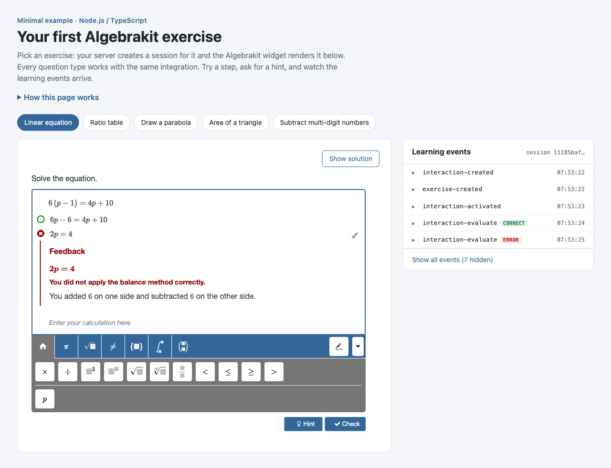

# Algebrakit examples

Runnable examples that show how to put [Algebrakit](https://algebrakit.com) math exercises in your own web application. Pick your server language, add your API key, and you have a working exercise on localhost in a few minutes.



## Pick your language

Each minimal example is a single server file plus the same small web page. They all do the same thing, so pick the language of your backend.

| Language | Example | SDK | Run it |
|---|---|---|---|
| Node.js / TypeScript | [minimal/typescript](minimal/typescript) | [`@algebrakit/sdk`](https://www.npmjs.com/package/@algebrakit/sdk) ([source](https://github.com/algebrakit/sdk-typescript)) | `npm install`<br>`cp .env.example .env`<br>`npm start` |
| PHP | [minimal/php](minimal/php) | [`algebrakit/sdk-php`](https://packagist.org/packages/algebrakit/sdk-php) ([source](https://github.com/algebrakit/sdk-php)) | `composer install`<br>`cp .env.example .env`<br>`composer start` |
| .NET / C# | [minimal/dotnet](minimal/dotnet) | [`Algebrakit.Sdk`](https://www.nuget.org/packages/Algebrakit.Sdk) ([source](https://github.com/algebrakit/sdk-dotnet)) | `dotnet user-secrets set ALGEBRAKIT_API_KEY <key>`<br>`dotnet run` |

Then open http://localhost:3000. You need an Algebrakit API key; if you don't have one yet, [contact Algebrakit](https://algebrakit.com/contact-us). Each example's README has the details.

Every example shows:

- **five question types**, each with the same integration code: a linear equation, a ratio table, drawing a parabola, the area of a triangle and multi-digit subtraction;
- **step-by-step feedback and hints**, which come from Algebrakit;
- **learning events**, the widget's reports of what the student does;
- **the solution**, shown for the same session without losing the student's work.

The browser side (`index.html`, `event-log.js`, `style.css`) is identical in every example. Only the server differs.

## How an Algebrakit integration works

An integration has three parts: your server creates a session, your page shows it with the Algebrakit widget, and the widget talks to Algebrakit through your server.

```text
 Browser                             Your server                         Algebrakit
    │                                     │                                   │
    │ 1. GET /?exercise=…                 │                                   │
    │────────────────────────────────────▶│ createSession(exerciseId)         │
    │                                     │──────────────────────────────────▶│
    │                                     │ session ID                        │
    │                                     │◀──────────────────────────────────│
    │ 2. page with                        │                                   │
    │    <akit-exercise session-id="…">   │                                   │
    │◀────────────────────────────────────│                                   │
    │                                     │                                   │
    │    page loads the widget script     │                                   │
    │    from widgets.algebrakit.com      │                                   │
    │─────────────────────────────────────┼──────────────────────────────────▶│
    │                                     │                                   │
    │ 3. widget API calls to              │ adds x-api-key                    │
    │    /proxy/algebrakit/*              │                                   │
    │────────────────────────────────────▶│──────────────────────────────────▶│
    │◀────────────────────────────────────│◀──────────────────────────────────│
    │                                     │                                   │
```

1. **Your server creates a session.** It calls `createSession()` from the SDK with an exercise ID and your API key. A session holds one student's work on one exercise.
2. **Your page shows the session.** It sets `AlgebraKIT = { config: { proxy: { url: '/proxy/algebrakit' } } }`, loads the widget script from `widgets.algebrakit.com`, and adds `<akit-exercise session-id="…">`. The config must come before the widget script.
3. **The widget talks to Algebrakit through your server.** Your API key must never reach the browser, so the widget sends its API calls to your server, which adds the key and forwards them.

The page can listen to learning events with `AlgebraKIT.addExerciseListener()`, and show the solution by rendering the same session with the `solution-mode` attribute.

## Going to production

The minimal examples are meant for localhost. Before you build on them:

- **Lock down the proxy.** The examples forward every request to Algebrakit with your key attached, for anyone who can reach the server. In your application, only forward the endpoints the widgets use, and only for logged-in users. You can send extra headers from the widget, such as a CSRF token, with `AlgebraKIT.config.proxy.headers`. See [Proxy setup](https://docs.algebrakit.com/pages/420-proxy-setup/).
- **Store the session ID** for each student and assignment, instead of creating a new session on every page load. Rendering a stored session ID lets the student continue where they left off.
- **Get results on your server.** Learning events are meant for your UI. For anything you store or grade, call `getSessionInfo()` from your server with the session ID.
- **Keep the API key in your server's configuration** (environment variables or a secret store), never in the page or in git.

## More

- [Algebrakit documentation](https://docs.algebrakit.com/): [integration approaches](https://docs.algebrakit.com/pages/230-integration-approaches/), [web service](https://docs.algebrakit.com/pages/300-webservice/) and [SDKs](https://docs.algebrakit.com/pages/320-SDK/)
- [OpenAPI specification](https://api.algebrakit.com/openapi/yaml), for languages without an SDK
- Coming next: a starter app with logins, stored sessions and a results view, and examples for embedding the exercise editors

Using a coding assistant? [AGENTS.md](AGENTS.md) describes how these examples are built and the rules for handling the API key.

## License

[MIT](LICENSE)
